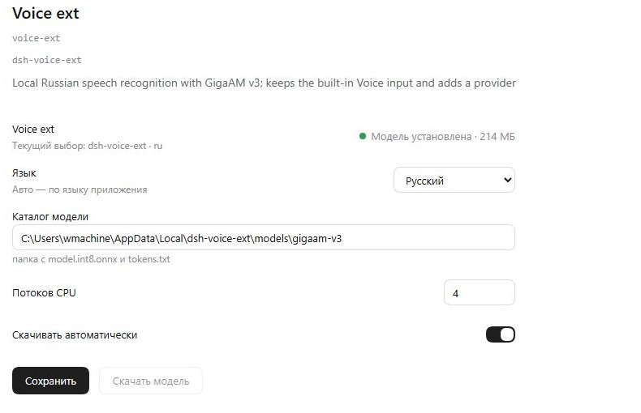

# dsh-voice-ext

Local **Russian** speech recognition for DeepSeek Harness.

The plugin does not replace the built-in Voice input: it adds a provider to the shared
`ctx.speechToText` service, so the microphone button, recording and text insertion stay stock.

```
microphone button → ctx.speechToText → provider dsh-voice-ext → GigaAM v3 (sherpa-onnx)
```

## Model

[GigaAM v3 CTC](https://github.com/salute-developers/GigaAM) (MIT), ONNX conversion
[sherpa-onnx-nemo-ctc-giga-am-v3-russian](https://huggingface.co/csukuangfj/sherpa-onnx-nemo-ctc-giga-am-v3-russian-2025-12-16).

- `model.int8.onnx` — 224,721,476 bytes, SHA-256 is verified after download;
- `tokens.txt` — the model vocabulary;
- default directory: `%LOCALAPPDATA%\dsh-voice-ext\models\gigaam-v3`;
- CPU, ~1.1 s for a 5.5-second phrase, no Python and no GPU.

## Settings

Page **Plugins → Voice ext**:

| Field | Default | Meaning |
|---|---|---|
| Model directory | `%LOCALAPPDATA%\dsh-voice-ext\models\gigaam-v3` | any directory with `model.int8.onnx` and `tokens.txt` |
| CPU threads | 2 | recognizer `numThreads` |
| Download automatically | on | fetch the model at start if it is missing |

Provider and language selection live in Voice input itself (the `speechToText` service);
this plugin declares the languages `ru` and `auto`.

Bridge for the form: `127.0.0.1:49234` — `GET /status`, `POST /settings`, `POST /prepare`.

## Languages

Interface languages: Russian, English, Chinese.

The interface language comes from the `language` extension setting when it is `ru`, `en` or
`zh`. The value `auto` follows the application language: `document.documentElement.lang`, then
`navigator.language`; `ru*` → `ru`, `zh*` → `zh`, otherwise `en`. With no setting at all the
default is `ru`.

The setting is changed in the plugin form **Plugins → Voice ext** and stored in the file
`%LOCALAPPDATA%\dsh-voice-ext\settings.json`.

## Profile configuration

```yaml
- insert:
    - id: voice-ext
      name: 'dsh-voice-ext'
      config:
        providerId: dsh-voice-ext
        language: ru
        threads: 2
        autoDownload: true
```

To make the plugin the default provider, name it in the `speech-to-text` entry:

```yaml
- id: speech-to-text
  config:
    defaultProvider: dsh-voice-ext
    language: ru
```

## Screenshots



## Installation

```json
"@machine202502/dsh-voice-ext": "^0.1.1"
```

and add `dsh-voice-ext` to `dsh.profile.bundles`. Installation pulls in
`sherpa-onnx-node@1.13.8` and the platform binary (`sherpa-onnx-win-x64` on Windows).
After a restart the provider is registered; if the model is not found and `autoDownload` is on,
it is downloaded at start (224 MB).

## Testing

```bash
node tests/probe.mjs      # recognizes tests/fixtures/sample-ru-16k.wav directly
node tests/provider.mjs   # registers the provider and recognizes through its API
```

Reference: «Вот мой голос, меня же слышно хорошо» — “Here is my voice, I can be heard well”.

A diagnostic run through the shared service is enabled with `selfTest: <path to wav>`;
the result is written to `%LOCALAPPDATA%\dsh-voice-ext\selftest.json`.

## Dependencies

`sherpa-onnx-node@1.13.8` and the platform binary (`sherpa-onnx-win-x64` etc.).

## License

MIT. The GigaAM model is distributed under MIT; the conversion is under the sherpa-onnx
license (Apache-2.0).
